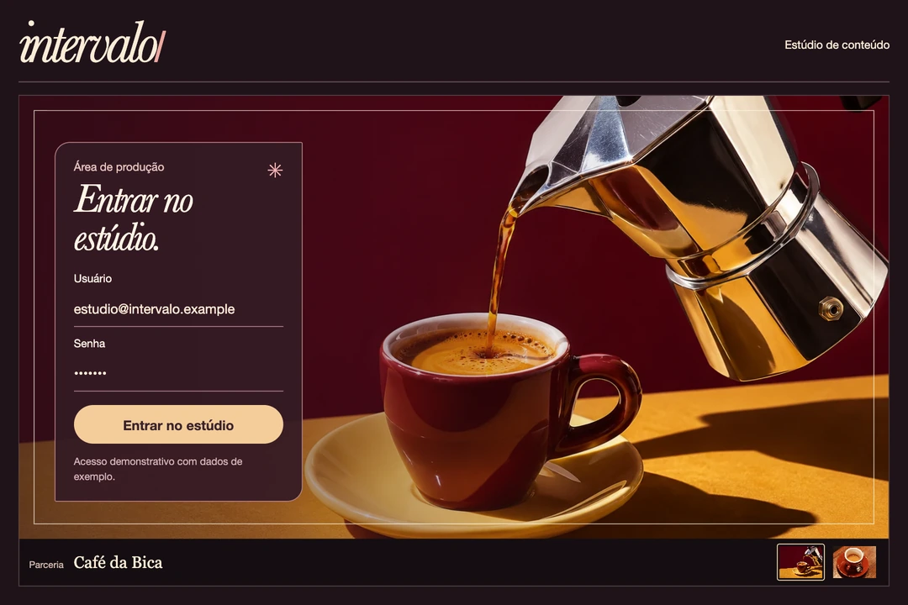

# Intervalo

O Café da Bica combinou duas entregas com o estúdio. As fotos do cardápio estão na segunda versão e o Reel vem depois. Aí a marca pede outro corte na foto de abertura. Como quem vai editar o vídeo fica sabendo que a primeira entrega continua em revisão?

Criei o Intervalo para acompanhar esse tipo de parceria. Cada entrega tem sua vez, sua versão e um espaço para dizer o que precisa mudar. O estúdio também consegue ver quando terminou o trabalho combinado e já pode registrar o recebimento do cachê.

**[Abrir a parceria do Café da Bica](https://cv.mauromota.com/demos/criadores.html)**

## Peça um ajuste na foto

1. Na parceria **Café da Bica**, procure **Fotos do novo cardápio** e clique em **Pedir ajuste**. Escreva “Abrir mais o enquadramento da primeira foto” e confirme.
2. A foto volta à produção como **v3**, com seu comentário visível. Envie a versão para aprovação e aprove a entrega. Agora dá para enviar o Reel.
3. Aprove também o Reel. O cachê passa para **A receber**. A pessoa responsável pode marcar **Registrar recebimento** quando o pagamento chegar.

Implementei essa sequência em JavaScript. A primeira entrega que ainda precisa de aprovação determina quais ações ficam disponíveis, e o registro do pagamento depende do conjunto das entregas. [Regras de revisão, aprovação e cachê](js/criadores.js)

## Rodar no seu computador

Baixe a pasta, abra `index.html` e escolha **Entrar no estúdio**. O login já está preenchido. Este é um projeto de portfólio em HTML, CSS e JavaScript, com marcas fictícias, acesso simulado e alterações salvas no navegador.

A foto do espresso no balcão é de Rachel Michetti (CC0).
